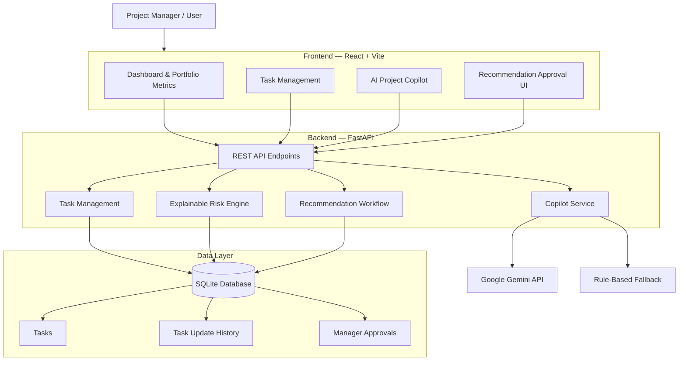

ProjectPulse AI is a hybrid enterprise operations command center. It uses a React + Vite frontend, a FastAPI backend, SQLite persistence, an explainable risk engine, and an optional Gemini-powered Project Copilot.

## 1. Architecture Diagram

The following Mermaid diagram describes the logical architecture of the prototype. GitHub and compatible Markdown viewers render it as a diagram.

## 2. Architecture Components

| Layer | Technology | Responsibility |
|---|---|---|
| Presentation | React + Vite | Renders the dashboard, task management interface, Copilot, and approval controls. |
| API | FastAPI | Exposes REST endpoints and handles communication between the frontend and backend. |
| Business Logic | Python | Handles task operations, risk calculations, and recommendation workflows. |
| AI Integration | Google Gemini API | Provides contextual responses to project-related Copilot questions when configured. |
| Fallback Logic | Deterministic rule-based logic | Provides fallback Copilot responses when Gemini is unavailable or not configured. |
| Persistence | SQLite + SQLAlchemy | Stores tasks, task update history, and manager approval records. |

## 3. Main Request Flow

1. The user interacts with the React dashboard.
2. The frontend sends an HTTP request to a FastAPI endpoint.
3. FastAPI routes the request to the relevant backend logic.
4. Task operations and risk calculations use the stored project data.
5. SQLite persists task details, update history, and approval decisions.
6. Copilot requests use Gemini when configured; otherwise, the rule-based fallback is used.
7. Recommendations are shown in the frontend for a manager to approve or reject.

## 4. Core Functional Areas

### Task Management
Users can create tasks, edit task details, submit structured updates, and view task history.

### Explainable Risk Engine
The backend calculates task risk using signals such as status, due dates, progress, and dependency-related information. The scoring is heuristic and explainable; it is not a validated predictive machine-learning model.

### Recommendation Workflow
The application generates task recommendations and stores them for manager review. A manager can approve or reject a recommendation. The prototype does not autonomously escalate tasks.

### Project Copilot
The Copilot provides project-related responses using Gemini when a valid configuration is available. A deterministic rule-based fallback is used when Gemini is unavailable or a request fails.

## 5. Data Model Overview

The SQLite database stores the following main record types:

- **Task:** Task details such as title, team, owner, status, progress, due date, priority, dependency, and description.
- **Update:** A task's submitted progress/status updates and notes, linked to the relevant task.
- **Approval:** Recommendation decisions, including approval status and review details, linked to the relevant task.

## 6. Scope and Limitations

- This diagram represents the logical architecture of the current prototype.
- The risk engine is heuristic decision support, not a validated predictive ML model.
- Gemini integration is optional and depends on local environment configuration.
- External integrations such as Slack, Microsoft Teams, Jira, and Google Workspace are not implemented.
- Authentication, role-based authorization, production secrets management, monitoring, and deployment hardening are not included.

---

**Project:** ProjectPulse AI 

**Purpose:** NxtWave Associate Project Management Intern assignment
